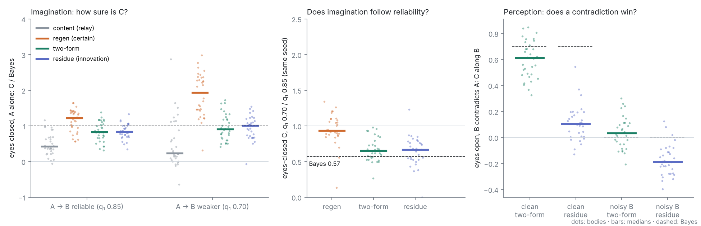
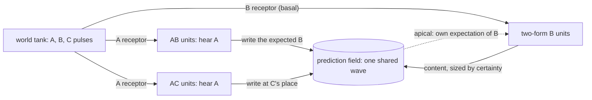

# WaveComputer — one body

**Everything the Qualia day found, in one learned wave body. It perceives, screens off a shortcut, imagines through a chain, keeps its confidence while imagining, and holds its surprise, all with one kind of unit and one set of weights.** Every rule set before the run held, most in 32 of 32 bodies.

Antti Luode's idea and direction · design, code and write-up by Claude Opus 5.5 · 17 November 2026.

[Protocol, committed before the batch](PROTOCOL.md) · [against the real thing](REAL_THING.md) · [receipt](experiments/results.json) · [summary](experiments/summary.json) · [machine](wavecomputer/machine.py) · [experiment](experiments/onebody.py) · [analysis](experiments/analyze.py) · [development runs](experiments/dev_results.json)



## Where this comes from

On 16 November, [QualiaClaude](https://github.com/anttiluode/QualiaClaude) and [QualiaAstra](https://github.com/anttiluode/QualiaAstra) ran 12 pre-registered experiments on Antti's idea of a **shared prediction**. [QualeX](https://github.com/anttiluode/QualeX) condensed them. The parts of a predictive wave computer were all found, but in different bodies, and each body failed exactly where another succeeded:

| | relay/ (sends content) | innovation/ (sends residue) |
|---|---|---|
| a real B contradicts A | C follows B | C barely moves |
| eyes closed, A alone | overconfident: 1.83 × Bayes | calibrated: 0.88 × Bayes |
| imagination chains on | yes | no |

QualeX section 3 proposed one unit that would hold both forms. This repository builds that unit, puts every surviving part into one machine, and asks the whole list of questions of the **same trained body**.

## The machine



Every branch tip also hears prediction − world at its own place; that residue is what all learning uses.

It is the A → B → C body of QualiaClaude relay/, with the same geometry, the same 72 calibrated fade-triggered units and the same damping-branch rule. The parts that survived the Qualia day are all switched on:

| Part | What it does | Where it was found |
|---|---|---|
| **two fields** | the world and the prediction are kept apart, so the expectation is held with a positive sign and can be passed on | QualeX 2.2 (chain/) |
| **residual learning** | every branch learns from what the *whole body* still leaves unexplained at its tip, so a redundant route is screened off | QualeX 2.3 (screen/) |
| **latched clocks** | once a unit's fade starts to fall, nothing recharges it before it fires, so the predicted event cannot reset the clock that predicts it | QualeX 2.4 (chain/ latch) |
| **regenerative timing** | an imagined B, once it crosses half a seen B's peak, finishes in the shape of a seen B, so imagination runs on time | QualeX 2.5 (relay/ regen) |
| **the two-form unit** | new: below | QualeX 3, proposed |

### The two-form unit: the damper becomes a transistor

Yesterday ended on the phrase "the damper becomes a transistor". Here is my reading of it. Until now, the prediction a unit's branches write did one job: **damping**. It cancels the expected wave at the tips, and the residue it leaves is what learning hears. In the two-form unit the same prediction gets a second job. It sets the **size of what the unit sends**, like a gate setting the current through a transistor.

Each B unit has two inputs on one clock:
- **basal**: the world's B, through the B receptor;
- **apical**: the prediction field at B's place, the body's own expectation of B, unscaled.

It always **learns from the residue** (prediction − world at its tips), like every unit here. It always **sends content**. The gate decides only how big that content is:

| | clock runs on | size of the ping |
|---|---|---|
| **evidence present** (B is seen) | the world's B | 1 |
| **imagining** (nothing seen) | the regenerated event | apical / seen: how high the unit's own fade climbed on its apical input, against how high a seen B drives it (at most 1) |

That is all. Two things are deliberately **not** in it.
- **No posterior formula for noisy evidence.** QualeX proposed one, the exact `E[s_B | A, b]`. In this world every sign is ±1, and then that posterior is **linear** in A and b (proof below). Residual learning at C's tip is a least-squares fit, so it should weight A and the seen B by their reliabilities on its own. Section N tests this.
- **Nothing from the readout.** The size comes from the unit's own fade and its own label-blind calibration peak. The size gain G that the regenerative timing uses is measured by the body on itself, as in relay/.

**Why the posterior is linear.** Any function of two ±1 variables is $`c_0 + c_1 s_A + c_2 b + c_3 s_A b`$. The exact posterior is odd: flipping both signs flips it. So $`c_0 = c_3 = 0`$, and

```math
E[s_B \mid s_A, b] \;=\; c_1 s_A + c_2 b,\qquad c_1 + c_2 = \frac{m_A + m_b}{1 + m_A m_b},\qquad c_1 - c_2 = \frac{m_A - m_b}{1 - m_A m_b},
```

with $`m_A = 2q_1 - 1`$ and $`m_b = 2r - 1`$. Precision weighting, here, is just two least-squares weights. A gain that multiplies is needed only where nothing is sensed, and that is imagination.

## Results

32 bodies per world, seeds 200001 to 200032. The same seed is paired across worlds: same schedule, only the reliability changed. All numbers are medians, sign-aligned so that + is the direction of the exact (Bayes) answer.

### The rules set beforehand

| Rule | Required | Measured | |
|---|---|---|---|
| **P1** a seen B that contradicts A makes C follow B | right sign ≥ 29/32, median ≥ 0.5 of Bayes | **32/32** and **32/32**; 0.87 and 0.87 of Bayes (q₁ = 0.85, 0.70) | pass |
| **P2** with B in view, A's own say over C is about zero | median \|A_given_B\| ≤ 0.15 | **0.04** and **0.04** | pass |
| **P3** eyes closed, A alone → imagined B → C | right sign ≥ 29/32 | **32/32** and **32/32** | pass |
| **P4** imagination follows the reliability of A → B (paired seeds) | median ratio in 0.40–0.80 (Bayes 0.57); closer than regen in ≥ 24/32 | **0.65**; closer than regen in **31/32** (regen: 0.93) | pass |
| **P5** the residue is held too: louder on contradiction | ≥ 29/32 | **32/32** and **32/32** (peak 0.40 vs 1.10 at q₁ = 0.85) | pass |
| **N1** noisy B: a contradiction sets C to about zero, with no gain anywhere | \|median\| ≤ 0.15; clean ≥ 0.35; clean above noisy ≥ 29/32 | **0.035** (Bayes 0); clean 0.61; **32/32** | pass |
| **N2** noisy B: A regains its say over C | median 0.15–0.50 (Bayes 0.33); above clean ≥ 29/32 | **0.26**; **32/32** | pass |

So the claim "one body does it all" (P1–P5) is shown in this setting, and so is precision weighting from learning alone (N1–N2).

### Imagination: how sure is C with eyes closed?

The same trained body, read four ways, as a fraction of the exact answer:

| Eyes closed, A alone → C | q₁ = 0.85 (Bayes 0.49) | q₁ = 0.70 (Bayes 0.28) | lower q₁ / higher q₁, same seed (Bayes 0.57) |
|---|---:|---:|---:|
| content (relay/: imagined B, normalized) | 0.42 | 0.23 | 0.41 |
| regen (imagined B as a certain event) | 1.22 | **1.94** | **0.93** |
| **two-form** | **0.83** | **0.91** | **0.65** |
| residue (innovation/, its own body) | 0.84 | 1.01 | 0.67 |

- **Regen does not follow reliability.** When A → B becomes less reliable, its imagined C stays almost where it was (ratio 0.93). Bayes says it should fall to 0.57 of its value. A certain event carries no "how sure".
- **Two-form does.** Its ratio is 0.65, about as close as the innovation body's 0.67. It is as well calibrated as innovation at q₁ = 0.85 (median |log error| 0.20 for both), slightly less at q₁ = 0.70 (0.29 against 0.22).

**Imagination itself adds no error.** The cleanest way to see this is to compare the eyes-closed C with what the body's own learned links would give: (strength of its imagined B) × (how much a seen B moves C).

| Eyes-closed C ÷ own links | q₁ = 0.85 | q₁ = 0.70 |
|---|---:|---:|
| **two-form** | **0.97** | **1.02** |
| regen | 1.37 | 1.96 |

The two-form body's imagination is **as sure as its own links justify, within 3%**. So the remaining gap to Bayes is in learning the links: a seen B moves C at 0.86–0.90 of Bayes. It is not in imagining. Regen is too sure, and more so the weaker its imagined B, because it sends a certain event whatever that strength was.

### Perception, and what the residue body can't do

| Eyes open, seen B contradicts A: C along B | clean, q₁ = 0.85 | noisy B (r = 0.85) |
|---|---:|---:|
| Bayes | 0.70 | **0** |
| **two-form body** | **0.61** (32/32 right sign) | **0.035** |
| residue body (innovation/) | 0.11 | **−0.19** |

- **The two-form body follows a clean contradiction, and sets a noisy one to about zero, as Bayes says.** Nothing in the unit knows about reliability. The difference comes only from what residual learning found in each world. A gets its say back when B is unreliable: 0.26 against Bayes 0.33, and 0.01 in the clean world.
- **The residue body is wrong in both worlds, in opposite directions.** With clean B, a contradiction barely moves C: 0.15 of Bayes, as innovation/ found. With noisy B, it overshoots past zero toward what A said, wrong-signed in 29 of 32 bodies.
- **The residue is still there, as a separate signal.** In the two-form body it is held at the dendrite and not sent. It peaks at 0.40 when B agrees and at 1.10 when B contradicts, in 32 of 32 bodies. Innovation sends that signal; the two-form unit keeps it.

### Predictions I got wrong

Recorded in the protocol before the run:
- **Contradiction strength.** I predicted 1.0–1.1 of Bayes; it was 0.87.
- **Two-form at q₁ = 0.70.** I predicted 0.7 of Bayes; it was 0.91. The ratio was 0.65, not about 0.55.
- **Where the shortfall sits.** I expected it in timing (the regenerated clock running late). The own-links ratio of 0.97–1.02 says it sits in the learned B → C link instead.
- **Innovation on a contradiction.** I predicted it would get the right sign in fewer than half of the q₁ = 0.85 bodies. It got 26 of 32, but at 0.15 of Bayes: the right sign, with almost no strength.
- **Noisy world, eyes closed.** Regen was nearer Bayes than two-form, as predicted (1.13 against 0.83), but both were higher than I said (1.0 and 0.7). Regen's closeness there is again errors cancelling: it sends a certain B, and with noisy evidence the direct A path is no longer screened off.

## What it means

1. **Content and residue are two jobs of one prediction, not two kinds of unit.** The prediction a unit writes damps the world at its tips (learning signal, surprise) and gates the size of what it sends (content). With both jobs in one unit, the trade-off of QualeX section 3 goes away in this body.
2. **The only place a size is needed is imagination.** When something is sensed, linear residual learning already does precision weighting, because with ±1 events Bayes is linear. When nothing is sensed, the unit must say how sure it is. Its own apical fade is enough, and it makes imagination as sure as its own links, within 3%.
3. **Imagination can be on time and uncertain at once.** Yesterday these pulled against each other. Regeneration made the imagined event on time but certain; the soft imagined wave was uncertain but late. Separating the clock (regenerated) from the size (apical) gives both.

## Against the real thing

[**REAL_THING.md**](REAL_THING.md) compares this machine, part by part, with four papers on dendrites, the axon initial segment and cortical time windows, and with Astra's two-step chain [WaveComputerAstra](https://github.com/anttiluode/WaveComputerAstra). It is a reading, not a result. In short:
- **Matches:** sending content with a context-set size (Marvan & Phillips); fixed absolute-time windows (Norman-Haignere et al.); thresholds calibrated to each unit's own input, a hand-made version of what the axon initial segment does (Fréal & Hoogenraad).
- **Half right:** our imagination is apical input driving the output, which the papers place in dreaming and imagination, not ordinary perception.
- **Mismatch:** our units fire later on bigger input; real neurons fire sooner.
- **The main gap:** in the cortex, rule and stimulus **multiply** in the apical dendrite (Zhang et al.), and that is the c₃·A·b term our symmetric worlds never needed. This machine only adds. The page ends on the test that follows: a rule world, with a slow apical state built from accumulated surprise multiplying the content, and a cut of the apical compartment that should break only the reversing trials.

## Ledger

**Shown** (pre-registered, passed): P1–P5 in one trained body; N1–N2, precision weighting from residual learning with no gain.

**Not shown:**
- calibration equal to Bayes: the body sits at 0.83–0.91 of Bayes, held back by its learned B → C link (0.86–0.90);
- anything beyond A → B → C: longer chains, more than two hidden worlds, discovered rather than supplied events;
- graded evidence. If a B's **size** carried its reliability, the exact posterior would no longer be linear, and a real gain would be needed. That is untested.

**Supplied, not learned:** event sites and timing, the regenerated shape (a stored seen-B wave), the latch, each unit's calibration peak, and the probe protocol.

**Known mechanisms:**
- the adaptive canceller (Widrow et al. 1975);
- least squares as explaining away;
- the Kalman innovation and predictive coding (Rao & Ballard 1999);
- apical amplification and context gain (Larkum; Marvan & Phillips 2024);
- precision weighting.

**Ours:**
- these combined in fade-triggered units on a wave field, under local rules;
- the two-form unit, with the clock split from the size;
- the own-links result (imagination adds no error);
- the residue body's two opposite failures;
- this fast, verified engine.

**What this does not touch:** whether anything is felt. Every result is about the structure of a shared prediction.

**What it is not:** a better computer. The waves are simulated on an ordinary CPU, so nothing here shows an advantage in speed, energy or accuracy over standard methods. It is a working instrument for studying how a learned wave body predicts.

## The engine: same machine, 55 times faster

QualiaClaude ran the vendored PerceptionLab node code, stepping a 96 × 96 wave solver every tick: about 0.8 s per episode, 3 minutes per body. But the field is linear. It is a damped wave equation with an absorbing edge, read as window means, and its one clip at ±4 is never reached. So it is fully described by its **impulse response**: write 1 at a site once, record all eight readouts on every later tick. [`wavecomputer/physics.py`](wavecomputer/physics.py) takes that kernel from the vendored node itself. [`wavecomputer/nodes.py`](wavecomputer/nodes.py) runs the fade clocks and damping branches as arrays, line for line the node code. An episode now takes 15 ms.

It is checked three ways:
- [`tests/test_equivalence.py`](tests/test_equivalence.py)
  - **nodes:** bit-identical to the vendored nodes over 139 pulses with learning;
  - **physics:** equal to the float32 solver within 4·10⁻⁷;
  - **bodies:** whole bodies trained through both engines read the same to four digits.
- [`tests/test_receipts.py`](tests/test_receipts.py): **all 48 published bodies** of QualiaClaude relay/ and innovation/, retrained from their schedules, match their published weights within **8·10⁻⁸**. The sensor waves there are taken bit-exact from the float32 node. Without that, a clock sitting within 10⁻⁷ of its threshold can flip by one tick and send a body's learning another way.

## Run

```sh
python -m pip install numpy matplotlib opencv-python-headless
python tests/test_equivalence.py          # nodes and physics against the vendored code (seconds)
python tests/test_equivalence.py --body   # whole bodies through both engines (about 5 minutes)
python tests/test_receipts.py             # all 48 published QualiaClaude bodies (about 4 minutes)
python experiments/dev.py                 # development bodies (2 minutes)
python experiments/run.py                 # the pre-registered batch, 192 bodies (6 minutes on two cores)
python experiments/analyze.py             # summary.json, scored against PROTOCOL.md
python experiments/figure.py              # onebody.png
```

## Lineage

- [QualiaClaude](https://github.com/anttiluode/QualiaClaude) at `13fba5d`: the bodies, rules and units this machine is built from. Its reference engines are kept in [`reference/`](reference/), and its receipts in [`reference/receipts/`](reference/receipts/).
- [QualiaAstra](https://github.com/anttiluode/QualiaAstra) at `8e706ed`: the engineered gates. Gates 5 and 6 (real vs imagined B) set up the problem the two-form unit answers.
- [QualeX](https://github.com/anttiluode/QualeX) at `d741506`: the condensation whose section 3 and open test this repository takes up.
- [StateShapedPingRecall](https://github.com/anttiluode/StateShapedPingRecall) (the damping rule), [PerceptionLabAI](https://github.com/anttiluode/PerceptionLabAI) and [GeometricNeuronV30](https://github.com/anttiluode/GeometricNeuronV30) (fade-triggered units). The nodes are vendored in [`vendor/`](vendor/).
- [Genealogy](https://anttiluode.github.io/Genealogy/)

T. Marvan and W. A. Phillips, "Cellular mechanisms of cooperative context-sensitive predictive inference", *Current Research in Neurobiology* 6 (2024) 100129.

MIT licence.
